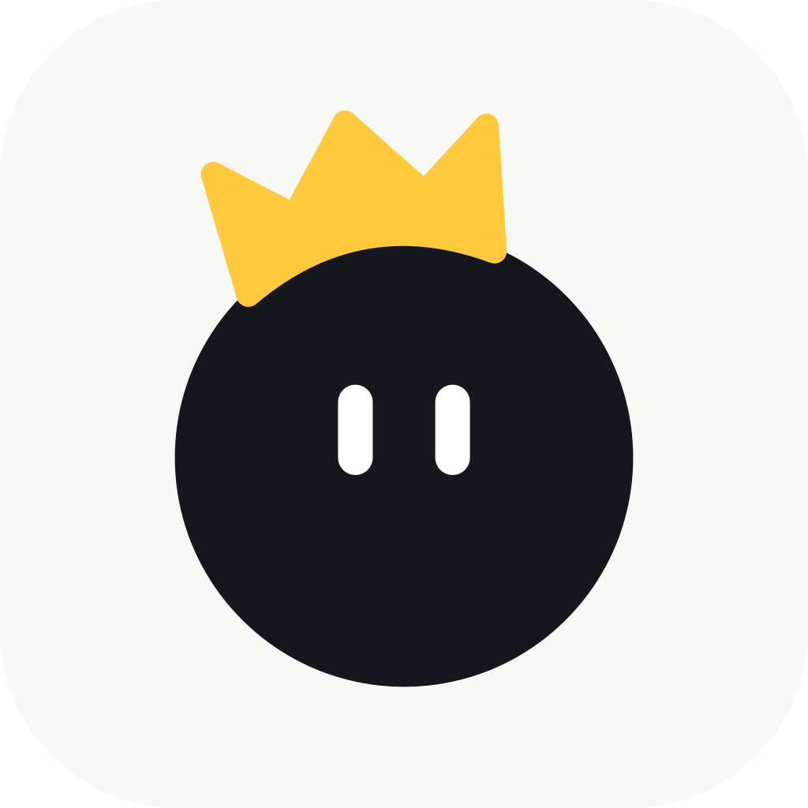
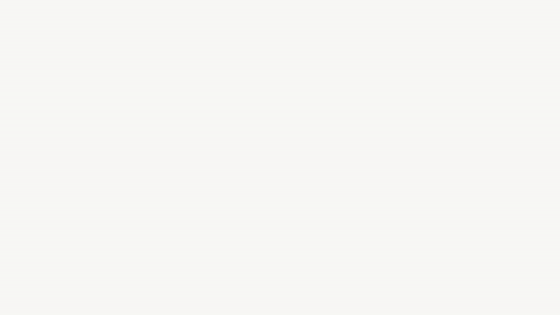

<p align="center"></p>

<h1 align="center">Orbi</h1>

Un monito animado: un círculo oscuro con dos rayitas por ojos, que flota. Trae un repertorio de animaciones
que se encadenan como piezas y accesorios que le llegan volando. Sale como página web, como video `.mp4` o
como `.webm` con fondo transparente para montarlo sobre otro video.



## Uso

```bash
python -m http.server 8731 --bind 127.0.0.1
```

- <http://127.0.0.1:8731/> muestra la escena de `escena.js`, con cámara lenta y una barra para recorrerla.
- <http://127.0.0.1:8731/galeria.html> muestra todas las animaciones a la vez.

```bash
node grabar.mjs                     # graba escena.js a monito.mp4
node grabar.mjs todos.js todos.mp4  # graba otra escena con otro nombre
```

Con `colores.fondo: "transparente"` sale un `.webm` con canal alfa.

Para grabar hacen falta Node.js y ffmpeg.

## Usarlo desde Claude Code

Este repo es también un plugin de Claude Code: le pides el clip con tus palabras («un video vertical de Orbi
poniéndose los lentes y bailando») y él escribe la escena, la revisa y la graba. Se instala así:

```
/plugin marketplace add safloresmo/orbi
/plugin install orbi@orbi
```

## Tu propia escena

Una escena es una lista de animaciones. Edita `escena.js` o crea otro archivo igual:

```js
import { secuencia, animaciones as a } from "./monito.js";

export default {
  fps: 60,
  colores: { fondo: "#f8f9f6", cuerpo: "#15171d", ojos: "#ffffff", acento: "#ff6a3d" },
  ...secuencia([
    a.entrar(),
    ["Hola", a.asentir()],                    // con rótulo en pantalla
    a.ponerse("audifonos", { crece: 1.5 }),
    a.celebrar(),
    a.salir(),
  ], { formato: "vertical" }),
};
```

- `formato`: `horizontal` (1920×1080), `vertical` (1080×1920) o `cuadrado` (1080×1080).
- Las posiciones van en unidades del escenario (480×270 en horizontal), con el origen en el centro e `y` hacia abajo.
- `tamano` y `en`, junto a `formato`, fijan el tamaño inicial y dónde empieza.
- `accesoriosPuestos: [{ tipo: "corona", color: "#ffc93d" }]` para los que ya trae desde el inicio.

## Animaciones

Cada una deja a Orbi en reposo, así que se encadenan en cualquier orden.

| Animación | Segundos | Qué hace |
|---|---|---|
| `entrar({ en, desde })` | 1.45 | Baja en un columpio en U y se asienta; `desde` "derecha" o "izquierda" |
| `salir({ hacia })` | 1.05 | Toma impulso, se deja caer y sale; `hacia` "derecha" o "izquierda" |
| `asomarse({ x })` | 2.2 | Se asoma por abajo, mira a los lados y se esconde |
| `moverA([x, y], dura)` | 0.8 | Se desliza en arco a otro punto |
| `flotar(dura)` | 2 | Se mece en su sitio |
| `pausa(dura)` | 0.5 | Quieto |
| `saltar(altura)` | 0.95 | Un salto |
| `voltereta()` | 1 | Vuelta completa en el aire |
| `celebrar()` | 1.7 | Dos saltitos de gusto |
| `bailar(compases)` | 1.2 por compás + 0.3 | Se balancea de lado a lado |
| `asentir()` | 0.9 | Dice que sí |
| `negar()` | 1 | Dice que no |
| `mirarAlrededor()` | 2 | Mira a un lado, parpadea, mira al otro |
| `curiosear()` | 1.6 | Ladea la cabeza y mira hacia arriba |
| `sorpresa()` | 1 | Se infla de golpe y vuelve |
| `temblar()` | 1 | Tiembla encogido con los ojos apretados |
| `dormir(dura)` | 3 | Se va quedando dormido y despierta |
| `crecer(factor, dura)` | 0.4 | Cambia de tamaño y se queda así |
| `ponerse(tipo, { color, desde, crece })` | 1.4 | Le llega un accesorio volando y se lo pone |
| `quitarse(tipo)` | 0.8 | Suelta ese accesorio, que sale volando |
| `aparecer(id, dibujo, { en, pegado })` | 0.6 | Aparece un objeto; Orbi lo mira |
| `moverObjeto(id, [x, y], dura)` | 0.7 | Mueve un objeto en arco; Orbi lo sigue con la vista |
| `vibrar(id, dura)` | 1 | El objeto se sacude (suena, tiembla) |
| `tomar(id, { en })` | 0.7 | Orbi toma el objeto y lo lleva pegado a la cabeza |
| `desaparecer(id)` | 0.45 | El objeto se encoge y se va |

Después de `salir` o `asomarse` queda fuera de cuadro: lo siguiente tiene que ser `entrar` o `asomarse`.

Accesorios: `audifonos`, `lentes`, `gorra` y `corona`.

## Más allá del repertorio

Las animaciones de la tabla son atajos, no un límite.

**Un movimiento propio** es un paso escrito a mano, con las pistas que quieras:

```js
const sobresalto = {
  dura: .7,
  pos:     [[0, [0, 0]], [.12, [0, -14], sale], [.45, [0, 0], ambas], [.7, [0, 0]]],
  deforma: [[0, [1, 1]], [.12, [.9, 1.14], sale], [.4, [1.05, .96], ambas], [.7, [1, 1], ambas]],
  ojos:    [[0, 1], [.12, 1.5, pasa], [.5, 1.5], [.7, 1, ambas]],
};
```

Pistas de Orbi: `pos`, `tam`, `ladeo`, `miraX`, `miraY`, `deforma` (aplastar y estirar), `ojos` (apertura),
`opacidad` y `parpadeos`. Cada clave es `[tiempo, valor, curva]`. Para que encadene bien, cada pista empieza con una
clave en el instante 0 y termina en reposo.

**Un elemento propio** es un objeto: cualquier SVG dibujado alrededor de (0,0). Puede estar suelto en la escena o
Orbi puede tomarlo y llevarlo.

```js
const abeja = `<ellipse rx="9" ry="6" fill="#ffc93d"/><path d="M-3 -6 V6 M3 -6 V6" stroke="#15171d" stroke-width="2.5"/>`;
...secuencia([
  a.aparecer("abeja", abeja, { en: [90, -40] }),
  a.moverObjeto("abeja", [-90, -30]),
  a.tomar("abeja", { en: [0, -44] }),
])
```

`DIBUJOS` trae `telefono`, `corazon`, `estrella` y `globo(texto)`, un globo de diálogo para que «hable».

**Un accesorio** (lo que se pone y se quita en la cabeza) es una entrada más en `ACCESORIOS`, en `monito.js`.

[`telefono.js`](telefono.js) es un ejemplo completo: suena un teléfono, Orbi se sobresalta, lo contesta y sale por la
izquierda. Grábalo con `node grabar.mjs telefono.js telefono.mp4`.

## Licencia

[MIT](LICENSE).
