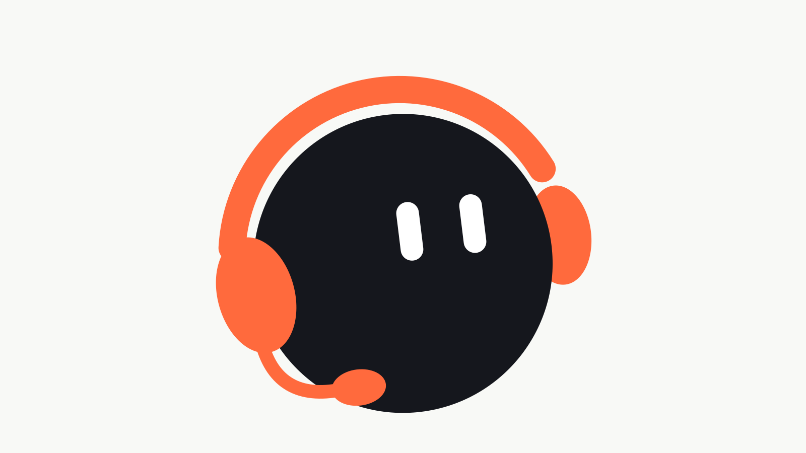

<p align="center"></p>

<p align="center"></p>

# Orbi

Un monito animado: un círculo oscuro con dos rayitas por ojos, que flota. Trae un repertorio de animaciones
que se encadenan como piezas y accesorios que le llegan volando. Sale como página web, como video `.mp4` o
como `.webm` con fondo transparente para montarlo sobre otro video.


## Descargar

- [`todos.mp4`](todos.mp4): un solo plano de 34 s con todas las animaciones y los cuatro accesorios.
- [`monito.mp4`](monito.mp4): la escena de ejemplo.
- Para hacer tus propios videos, clona el repo o baja el ZIP desde **Code → Download ZIP**.

## Requisitos

- Para verlo: cualquier navegador actual y un servidor de archivos (los módulos no cargan desde `file://`).
- Para grabar video: [Node.js](https://nodejs.org) 18 o más nuevo y [ffmpeg](https://ffmpeg.org) compilado con
  `librsvg` (compruébalo con `ffmpeg -decoders | grep svg`).

No hay dependencias que instalar.

## Configuración

Orbi no necesita variables de entorno. Si algún día hace falta una, estará declarada en `.env.schema` y se
podrá fijar en `.env.local` o como variable de entorno.

## Uso

```bash
python -m http.server 8731 --bind 127.0.0.1
```

- <http://127.0.0.1:8731/> muestra la escena de `escena.js`, con cámara lenta y una barra para recorrerla.
- <http://127.0.0.1:8731/galeria.html> muestra todas las animaciones a la vez.

```bash
node grabar.mjs                     # graba escena.js a monito.mp4
node grabar.mjs todos.js todos.mp4  # graba otra escena con otro nombre
```

Con `colores.fondo: "transparente"` sale un `.webm` con canal alfa.

## Usarlo desde Claude Code

Este repo es también un plugin de Claude Code: le pides el clip con tus palabras («un video vertical de Orbi
poniéndose los lentes y bailando») y él escribe la escena, la revisa y la graba. Se instala así:

```
/plugin marketplace add safloresmo/orbi
/plugin install orbi@orbi
```

## Tu propia escena

Una escena es una lista de animaciones. Edita `escena.js` o crea otro archivo igual:

```js
import { secuencia, animaciones as a } from "./monito.js";

export default {
  fps: 60,
  colores: { fondo: "#f8f9f6", cuerpo: "#15171d", ojos: "#ffffff", acento: "#ff6a3d" },
  ...secuencia([
    a.entrar(),
    ["Hola", a.asentir()],                    // con rótulo en pantalla
    a.ponerse("audifonos", { crece: 1.5 }),
    a.celebrar(),
    a.salir(),
  ], { formato: "vertical" }),
};
```

- `formato`: `horizontal` (1920×1080), `vertical` (1080×1920) o `cuadrado` (1080×1080).
- Las posiciones van en unidades del escenario (480×270 en horizontal), con el origen en el centro e `y` hacia abajo.
- `tamano` y `en`, junto a `formato`, fijan el tamaño inicial y dónde empieza.
- `accesoriosPuestos: [{ tipo: "corona", color: "#ffc93d" }]` para los que ya trae desde el inicio.

## Animaciones

Cada una deja a Orbi en reposo, así que se encadenan en cualquier orden.

| Animación | Segundos | Qué hace |
|---|---|---|
| `entrar({ en })` | 1.45 | Baja en un columpio en U y se asienta |
| `salir()` | 1.05 | Toma impulso, se deja caer y sale por la derecha |
| `asomarse({ x })` | 2.2 | Se asoma por abajo, mira a los lados y se esconde |
| `moverA([x, y], dura)` | 0.8 | Se desliza en arco a otro punto |
| `flotar(dura)` | 2 | Se mece en su sitio |
| `pausa(dura)` | 0.5 | Quieto |
| `saltar(altura)` | 0.95 | Un salto |
| `voltereta()` | 1 | Vuelta completa en el aire |
| `celebrar()` | 1.7 | Dos saltitos de gusto |
| `bailar(compases)` | 1.2 por compás + 0.3 | Se balancea de lado a lado |
| `asentir()` | 0.9 | Dice que sí |
| `negar()` | 1 | Dice que no |
| `mirarAlrededor()` | 2 | Mira a un lado, parpadea, mira al otro |
| `curiosear()` | 1.6 | Ladea la cabeza y mira hacia arriba |
| `sorpresa()` | 1 | Se infla de golpe y vuelve |
| `temblar()` | 1 | Tiembla encogido con los ojos apretados |
| `dormir(dura)` | 3 | Se va quedando dormido y despierta |
| `crecer(factor, dura)` | 0.4 | Cambia de tamaño y se queda así |
| `ponerse(tipo, { color, desde, crece })` | 1.4 | Le llega un accesorio volando y se lo pone |
| `quitarse(tipo)` | 0.8 | Suelta ese accesorio, que sale volando |

Después de `salir` o `asomarse` queda fuera de cuadro: lo siguiente tiene que ser `entrar` o `asomarse`.

Accesorios: `audifonos`, `lentes`, `gorra` y `corona`.

## Añadir animaciones y accesorios

Todo está en `monito.js`.

Una animación es una entrada más en `animaciones`: una función que devuelve sus pistas, con tiempos desde 0 y
posiciones relativas a donde está parado.

```js
saludar: () => ({
  dura: 1.2,
  pos:   [[0, [0, 0]], [.3, [0, -8], a], [1.2, [0, 0], a]],
  ladeo: [[0, 0], [.3, 14, a], [.6, -8, a], [.9, 10, a], [1.2, 0, a]],
  miraY: [[0, 0], [.3, -.4, a], [1.2, 0, a]],
  parpadeos: [[.7, .25]],
}),
```

Cada clave es `[tiempo, valor, curva]`. Para que encadene bien, cada pista empieza con una clave en el instante 0
y termina en reposo: posición `[0, 0]`, tamaño 1, ladeo 0 y mirada 0.

Un accesorio es una entrada más en `ACCESORIOS`: una función del color que devuelve trozos de SVG dibujados
alrededor del centro de la cabeza (radio 33): `atras`, `frente` y `volando`.

Añade una muestra a `galeria.js` para verlo junto a los demás.

## Licencia

[MIT](LICENSE).
